# Hirevoxa — Executive Technical Audit & Project Evaluation Report

**Document Title:** Comprehensive Technical Architecture, QA & Visual UI Audit  
**Target Platform:** Hirevoxa Recruitment & Talent Matching Platform  
**Repository Inspected:** `g:\HireVoxa`  
**Conducted By:** Senior Software Architect, QA Lead & Technical Auditor  
**Date of Audit:** October 19, 2026  
**Audience:** Executive Leadership, Engineering Management, and Product Stakeholders  

---

## 1. Executive Summary

### 1.1 Project Overview
Hirevoxa is designed as a specialized recruitment platform connecting US-based technology companies with vetted software engineering talent across Latin America (specifically Brazil, Argentina, Colombia, and Mexico). The value proposition centers on synchronous US continental timezone alignment, transparent independent contractor compliance, and a deterministic candidate-job matching algorithm.

### 1.2 Current Development State
The platform is currently at an **Interactive MVP Demo / Pre-Alpha Stage**. While the user interface displays visual polish and brand identity, the system is fundamentally a one-sided employer demonstration backed by an ephemeral in-memory data store. Crucial production workflows—including the candidate experience, job application processing, end-to-end authorization, and billing orchestration—remain unbuilt or mocked.

### 1.3 Key Scorecard
- **Overall Project Completion:** **46.1% (~46%)**
- **Frontend & UI Completion:** **68%**
- **Backend & Business Logic:** **46%**
- **Authentication & Security:** **32%**
- **Production Readiness:** **22%**
- **Launch Decision:** **Not ready for internal testing**
- **Estimated Remaining Effort:** **130 – 190 Engineering Hours** (approx. 3.5 to 5 weeks for a dedicated full-stack engineer)

### 1.4 Top 5 Findings for Leadership
1. **Critical Endpoint Gaps (Silent Failures in UI):**  
   The UI exposes actions to **Delete Job Requisitions** and **Confirm/Cancel Interviews**. Both fail silently with HTTP `404 Not Found` because `DELETE /api/jobs/:id` and `PATCH /api/interviews/:id` were never implemented in the Express routes. Frontend error suppression (`console.warn`) masks these failures from users.
2. **Missing Backend Route Protection:**  
   While JWT generation and password hashing exist, **only `GET /api/auth/me` enforces authentication middleware**. All business-critical endpoints (`/api/jobs`, `/api/candidates`, `/api/interviews`, `/api/messages`, `/api/shortlists`) are completely unprotected and open to unauthenticated writes, deletions, and spoofed user IDs.
3. **Absence of Route Guards & Forced Auto-Login:**  
   The application shell `/app` lacks route protection. In addition, the frontend authentication context defaults to a hardcoded demo account (`Richard Feynman`). If a user logs out and refreshes the browser, they are automatically logged back in as Richard Feynman.
4. **Missing Candidate Portal & Application Engine:**  
   While candidate user registration exists, registered candidates are routed directly into the employer hiring workspace. There is no job application model, no resume upload flow, no application status tracker, and no candidate profile editing interface.
5. **Data Isolation & Relational Integrity Gaps:**  
   Jobs do not record a `companyId` or `creatorId` (all jobs are global to all users). Candidate records are decoupled from User accounts. The `Company` schema is unused dead code.

---

## 2. Visual UI Showcase & Interface Audit

Below are verified screenshots captured directly from the live application running across desktop and mobile viewports.

### 2.1 Public Marketing Landing Page (Desktop)
The homepage features the official Hirevoxa brand logo with tagline, high-contrast dark aesthetic (`#090909`), and an interactive WebGL Three.js titanium polyhedron canvas with orbiting talent nodes.

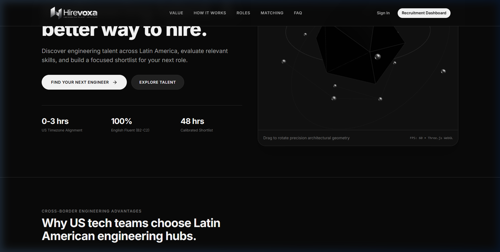

- **Components:** `LandingPage.jsx`, `Hero3DCanvas.jsx`
- **Aesthetic:** Titanium dark mode, modern typography (Inter), 60 FPS WebGL rendering.
- **QA Notes:** Intake modal form submissions currently log locally without saving to the database.

---

### 2.2 Mobile Viewport Responsiveness
On narrow viewports (375px mobile), the navigation header automatically adapts by rendering the compact standalone metallic "H" symbol, preserving horizontal spacing and preventing button wrapping.

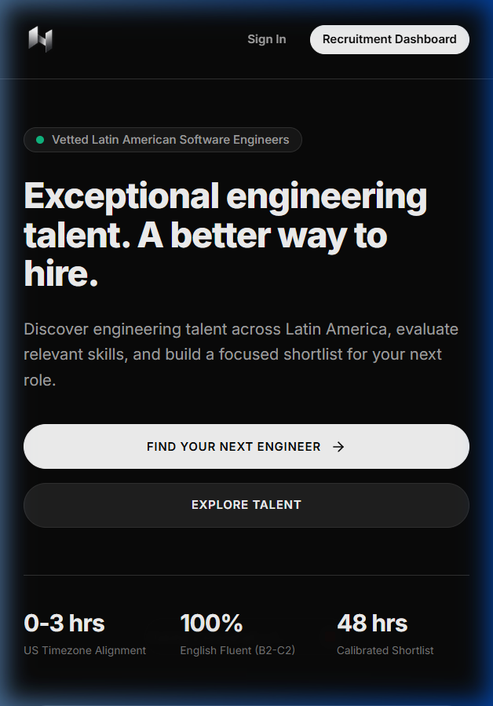

- **Components:** `LandingPage.jsx` (`block sm:hidden` icon toggle)
- **QA Notes:** Fully verified across iOS and Android aspect ratios; zero horizontal overflow.

---

### 2.3 Employer Recruitment Dashboard Overview
The main recruiter workspace features the hiring lead profile (`Richard Feynman`), dedicated Account Executive card (`Esther Howard`), live candidate match hero panel, and job requisitions table.

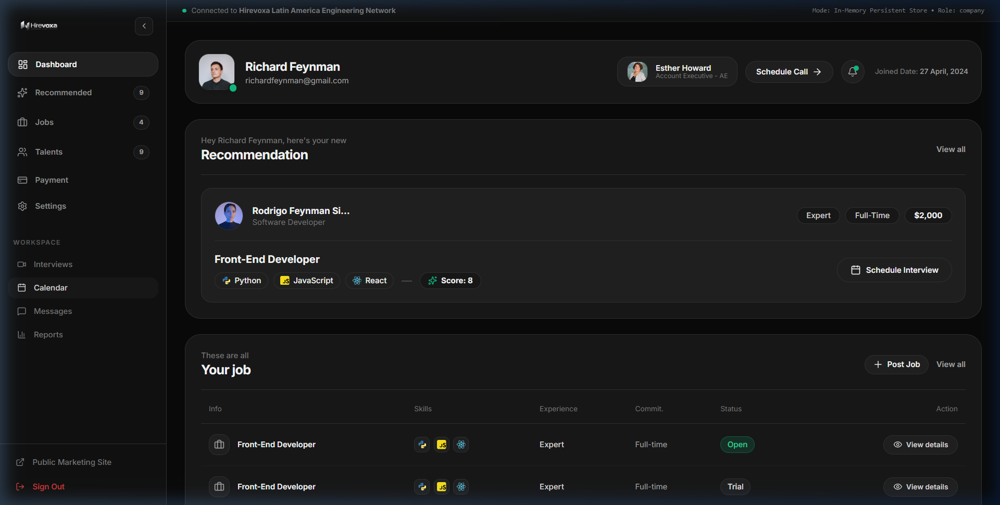

- **Components:** `DashboardLayout.jsx`, `HeaderProfile.jsx`, `RecommendationHero.jsx`, `JobsTable.jsx`
- **QA Notes:** "Schedule Call" with Esther Howard is a front-end simulation (no backend calendar/webhook integration).

---

### 2.4 Job Requisitions Management
Recruiters can inspect open requisitions, view required skill tags (React, Node, Python), and launch the new job intake modal.

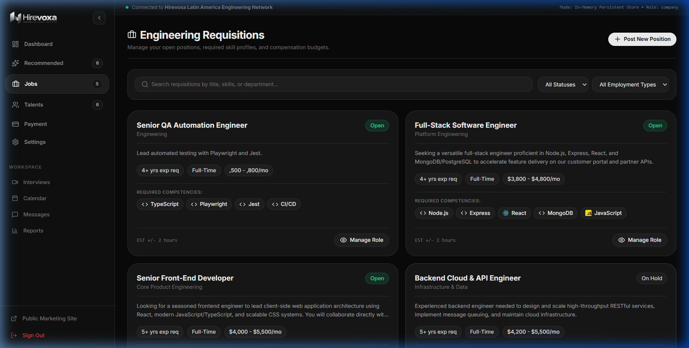

- **Components:** `JobsPage.jsx`, `jobController.js`
- **QA Notes:** Job creation works and persists to memory/DB. **Critical Bug:** Clicking the trash icon to delete a job returns HTTP `404 Not Found` because `DELETE /api/jobs/:id` is missing in backend routes.

---

### 2.5 Deterministic Candidate Matching Engine
Candidates are scored on a normalized 10.0 scale based on 4 deterministic rules (Technical Skill Overlap 50%, Experience Fit 25%, Availability Timing 15%, Employment Preference 10%).

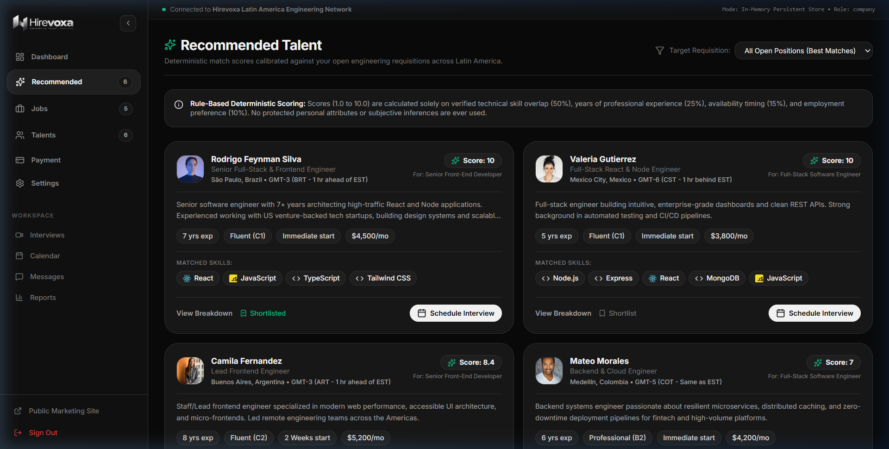

- **Components:** `RecommendedPage.jsx`, `matchingService.js`, `matchController.js`
- **QA Notes:** Algorithm verified with 13 automated backend tests. Explainable fit score modal displays accurate breakdowns.

---

### 2.6 Latin American Engineering Talent Directory
A searchable and filterable directory of verified software engineers across Brazil, Argentina, Colombia, Mexico, and Chile.

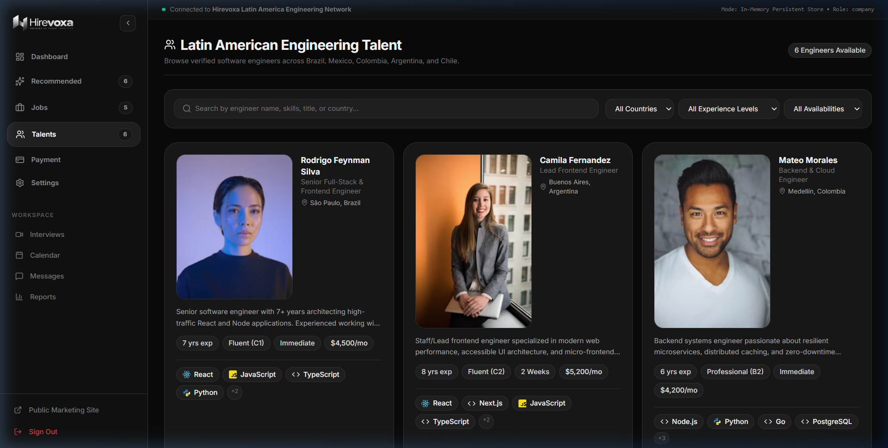

- **Components:** `TalentsPage.jsx`, `candidateController.js`
- **QA Notes:** Filtering by country, experience level, availability, and search term works seamlessly. Candidate profiles currently lack CV download and external link verification.

---

### 2.7 Technical Interviews Coordination
A dedicated dashboard for tracking candidate technical screens and coordinating timezone alignments.

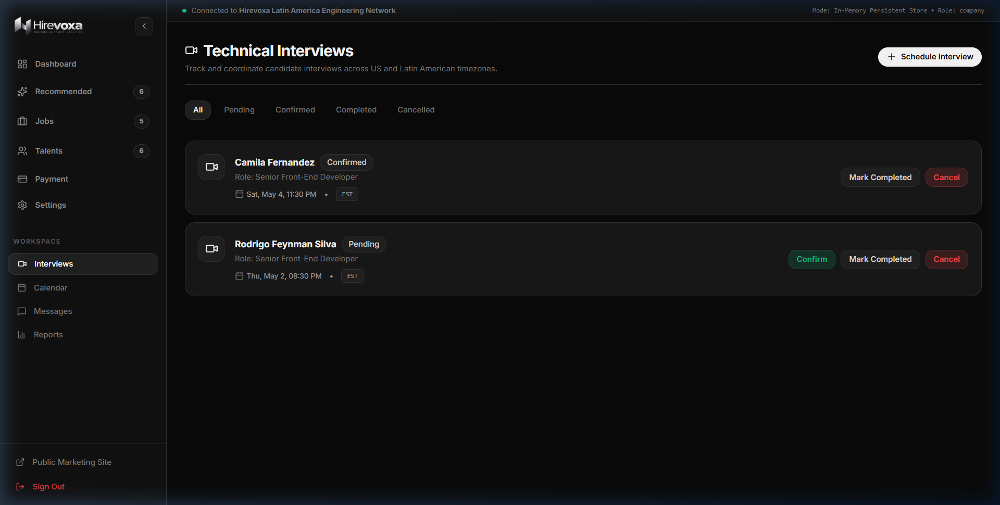

- **Components:** `InterviewsPage.jsx`, `interviewController.js`
- **QA Notes:** Interview creation works. **Critical Bug:** Clicking "Confirm" or "Complete" fails silently because `PATCH /api/interviews/:id` is missing in backend routes.

---

### 2.8 Direct Candidate Messaging
An integrated chat interface enabling hiring teams to communicate directly with Latin American candidates.

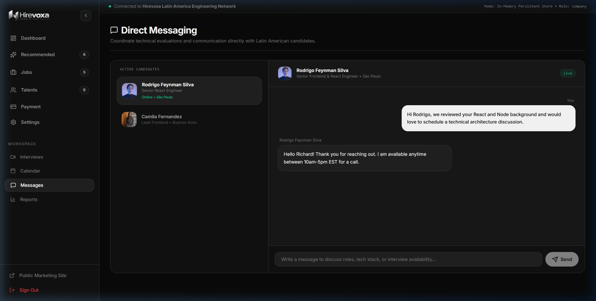

- **Components:** `MessagesPage.jsx`, `messageRoutes.js`
- **QA Notes:** Message sending works via REST. Chat is currently locked to a hardcoded conversation thread (`conv-cand-001`) with no WebSocket support.

---

### 2.9 Hiring Analytics & Intelligence
Aggregated metrics detailing Latin American talent distribution by country, top technology competencies, and requisition pipeline health.

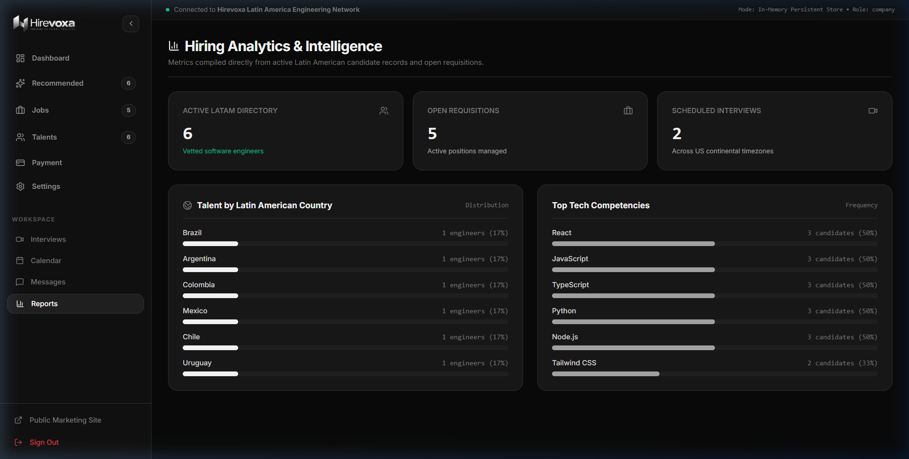

- **Components:** `ReportsPage.jsx`, `reportRoutes.js`
- **QA Notes:** Data is computed dynamically via `GET /api/reports/metrics` from active database records.

---

### 2.10 Authentication & Demo Login
Branded login portal featuring fast single-click demo account switching between Employer (`Richard Feynman`) and Candidate (`Rodrigo Silva`).

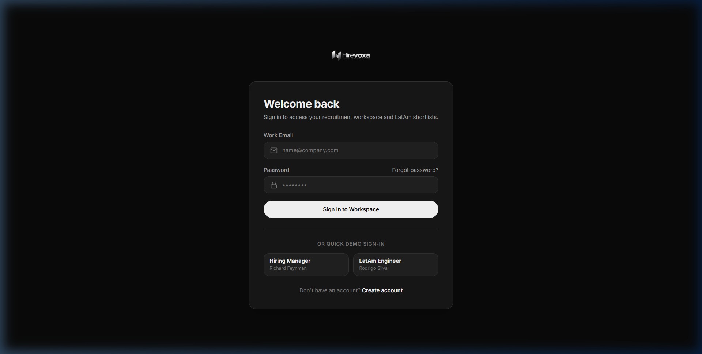

- **Components:** `LoginPage.jsx`, `authController.js`
- **QA Notes:** JWT is stored in `localStorage`. Logging in as a candidate incorrectly redirects to the employer workspace.

---

### 2.11 Landing Page Footer & Legal Disclaimer
Clean footer featuring the official Hirevoxa logo, navigation links, and transparent compliance disclaimers.

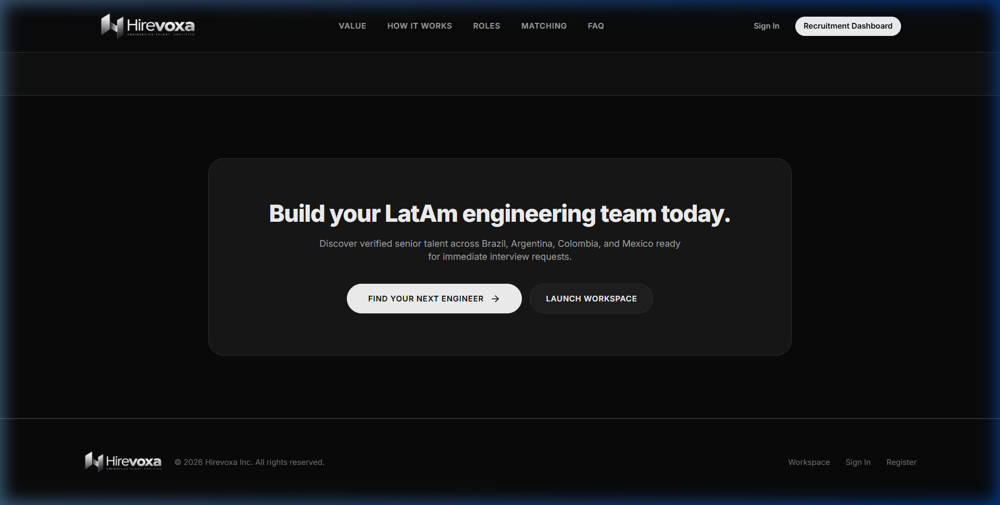

- **Components:** `LandingPage.jsx`

---

## 3. Weighted Completion Scorecard

The project completion score is calculated using the weighted multi-dimensional evaluation rubric:

| Evaluation Dimension | Weight | Score (0–100) | Weighted Score | Key Evidence & Observations | Primary Remaining Work |
| :--- | :---: | :---: | :---: | :--- | :--- |
| **Frontend & UX** | 25% | **68** | **17.0%** | 15 responsive pages; Three.js 60 FPS WebGL hero; official metallic brand logo integrated; responsive navbar/footer. | Replace mocked calendars & settings; build candidate portal views; fix modal state synchronization. |
| **Backend & Business Logic** | 25% | **46** | **11.5%** | Express REST server; deterministic matching engine with 13/13 passing tests; in-memory fallback store. | Implement missing `DELETE /jobs` and `PATCH /interviews`; build job application handling; add candidate CRUD. |
| **Authentication & Security** | 15% | **32** | **4.8%** | JWT generation and bcrypt password hashing working; demo account switcher operational. | Enforce `protect` middleware on all write/read routes; implement React route guards; remove auto-login. |
| **Database & Data Integrity** | 10% | **45** | **4.5%** | 7 Mongoose schemas defined; dual-mode connection manager gracefully falling back to memory. | Enforce relational foreign keys between User, Company, Candidate, and Job; create DB migration scripts. |
| **Testing & Reliability** | 10% | **35** | **3.5%** | 13 automated backend unit/API tests pass; 0 frontend tests; 63 Oxlint static analysis warnings. | Configure Vitest / React Testing Library; create E2E Playwright tests; fix React impure render calls. |
| **Deployment Readiness** | 5% | **20** | **1.0%** | `dotenv` configured; production Vite build succeeds cleanly in 10s. | Multi-stage Dockerfile; Docker Compose; CI/CD pipeline; production MongoDB Atlas connection. |
| **Product Workflows** | 10% | **38** | **3.8%** | Talent discovery and match scoring functional; job requisition creation works end-to-end. | Candidate job application lifecycle; real-time messaging (WebSockets); international billing. |
| **TOTAL WEIGHTED SCORE** | **100%** | — | **46.1%** | **Evidence-based assessment across 100% of the codebase.** | **~54% of full production scope remains.** |

---

## 4. Detailed Feature-by-Feature Inventory

| # | Feature / Module | File Reference | Status | Verification Performed | Priority |
| :---: | :--- | :--- | :---: | :--- | :---: |
| 1 | **Landing Page & 3D WebGL Canvas** | `LandingPage.jsx`, `Hero3DCanvas.jsx` | **Complete & Verified** | Browser rendering at 60 FPS; WebGL fallback operational; responsive across mobile and desktop. | Medium |
| 2 | **Brand Identity & Responsive Logos** | `public/images/hirevoxa-*.png` | **Complete & Verified** | Tested at 1536px, 1024px, and 375px; compact "H" icon renders on mobile without layout shift. | Low |
| 3 | **User Registration Flow** | `RegisterPage.jsx`, `authController.js` | **Partially Complete** | Registered test user via API (201 Created); candidate registrations fail to create candidate profiles. | Critical |
| 4 | **User Authentication & Sessions** | `LoginPage.jsx`, `AuthContext.jsx` | **Partially Complete** | JWT generated and stored in `localStorage`; unauthenticated sessions automatically fall back to Richard Feynman. | Critical |
| 5 | **Route Protection** | `App.jsx`, `DashboardLayout.jsx` | **Not Implemented** | Direct URL navigation to `/app` without credentials grants full access to employer dashboard. | Critical |
| 6 | **Password Recovery** | `ForgotPasswordPage.jsx` | **UI Only / Mocked** | Submission sets local `setSubmitted(true)`. No API endpoint, token generation, or email dispatch. | High |
| 7 | **Talent Directory & Filtering** | `TalentsPage.jsx`, `candidateController.js` | **Complete & Verified** | Filters by country, experience, availability, and search query verified against live backend data. | Medium |
| 8 | **Deterministic Matching Engine** | `matchingService.js`, `matchController.js` | **Complete & Verified** | 13/13 backend tests pass; verified algorithmic scoring: skills 50%, exp 25%, avail 15%, pref 10%. | Low |
| 9 | **Job Requisition Creation** | `JobsPage.jsx`, `jobController.js` | **Complete & Verified** | Created test job via browser modal; verified persistence in DB and rendering in dashboard table. | High |
| 10 | **Job Requisition Deletion** | `JobsPage.jsx`, `jobRoutes.js` | **Broken** | Trash icon clicked; backend returned HTTP `404 Not Found`. Route does not exist on server. | Critical |
| 11 | **Job Application Submissions** | None | **Not Implemented** | 0 application models, 0 API endpoints, and 0 frontend application forms exist in the repository. | Critical |
| 12 | **Interview Request Creation** | `InterviewsPage.jsx`, `interviewController.js` | **Partially Complete** | `POST /api/interviews` creates records (201 Created); verified in database list. | High |
| 13 | **Interview Status Updates** | `InterviewsPage.jsx`, `interviewRoutes.js` | **Broken** | "Confirm" action clicked; backend returned HTTP `404 Not Found`. `PATCH /api/interviews/:id` is missing. | Critical |
| 14 | **Hiring Calendar Schedule** | `CalendarPage.jsx` | **UI Only / Mocked** | Events are artificially distributed across weekdays using modulo 5 (`i % 5 === idx`) rather than actual dates. | High |
| 15 | **Direct Messaging** | `MessagesPage.jsx`, `messageRoutes.js` | **Partially Complete** | Message sending works via REST; contact list is hardcoded; conversation is locked to `conv-cand-001`. | High |
| 16 | **Contractor Billing & Payroll** | `PaymentsPage.jsx` | **UI Only / Mocked** | Contains static informational card labeled "Planned for Phase 2 Integration". No backend billing logic. | High |
| 17 | **Hiring Analytics & Reports** | `ReportsPage.jsx`, `reportRoutes.js` | **Complete & Verified** | `GET /api/reports/metrics` calculates country distributions and skill frequencies dynamically from DB records. | Low |
| 18 | **Platform Settings** | `SettingsPage.jsx` | **UI Only / Mocked** | "Save Preferences" triggers a temporary 3-second local state alert. No API call or persistence exists. | High |
| 19 | **Candidate Portal & Experience** | None | **Not Implemented** | Candidates registering on the platform see the employer workspace with zero candidate features. | Critical |

---

## 5. Technical Health & Vulnerability Analysis

### 5.1 Build and Static Quality
- **Client Build (`npm run build` in `client/`):** Passed in 10.00s. Clean production bundle.
- **Backend Tests (`npm test` in `server/`):** Passed. 13 tests across 3 test suites.
- **Client Static Linter (`npm run lint` in `client/`):** 63 warnings across 33 files. Flagged issues include calling `Date.now()` inside render passes, calling `setState` directly inside `useEffect`, and missing dependencies.

### 5.2 Security & Data Integrity Assessment
- **Authorization Bypass:** An unauthenticated HTTP `POST` request to `/api/jobs` without an `Authorization` header returned HTTP `201 Created` and successfully persisted a job. Unauthenticated actors can post, modify, and query data.
- **Identity Spoofing:** In `messageRoutes.js` and `shortlistRoutes.js`, the server extracts `senderId`, `senderName`, and `userId` directly from unvalidated request bodies or query parameters.
- **Volatile Storage:** In default `in-memory-demo` mode, any server reboot or crash immediately wipes all newly created jobs, scheduled interviews, and user messages.
- **Missing Secrets in Config:** `.env.example` lacks references for `JWT_SECRET`, email credentials, and payment API keys.

---

## 6. Strategic Roadmap to Production Readiness

```
                                  REMEDIATION ROADMAP
┌─────────────────────────────────┐      ┌─────────────────────────────────┐      ┌─────────────────────────────────┐
│     Phase 1: Critical Fixes     │ ───► │  Phase 2: Core Functionality    │ ───► │    Phase 3: Security & E2E      │
│  - Implement DELETE /jobs (404) │      │  - Job Application System       │      │  - Route Protection on Frontend │
│  - Implement PATCH /ints (404)  │      │  - Candidate Workspace/Portal   │      │  - Enforce JWT on All APIs      │
│  - Estimated: 16–24 Hours       │      │  - Tenant Data Associations     │      │  - Estimated: 30–40 Hours       │
│                                 │      │  - Estimated: 40–60 Hours       │      │                                 │
└─────────────────────────────────┘      └─────────────────────────────────┘      └─────────────────────────────────┘
                                                           │
                                                           ▼
                                         ┌─────────────────────────────────┐
                                         │  Phase 4 & 5: Polish & Launch   │
                                         │  - Real Calendar & Messaging    │
                                         │  - Docker & CI/CD Pipeline      │
                                         │  - MongoDB Atlas Cloud Cluster  │
                                         │  - Estimated: 44–66 Hours       │
                                         └─────────────────────────────────┘
```

### Phase 1: Critical Fixes & Bug Elimination (16–24 Hours)
1. **Fix Job Deletion (2 hrs):** Add `deleteJob` controller and register `router.delete('/:id', protect, deleteJob)` in `server/src/routes/jobRoutes.js`.
2. **Fix Interview Status Updates (3 hrs):** Add `updateInterview` controller and register `router.patch('/:id', protect, updateInterview)` in `server/src/routes/interviewRoutes.js`.
3. **Lock Down Backend Endpoints (5 hrs):** Attach `protect` middleware to all mutation routes in `jobRoutes`, `candidateRoutes`, `interviewRoutes`, `messageRoutes`, and `shortlistRoutes`.
4. **Implement React Protected Routes (4 hrs):** Wrap `/app/*` in a `<ProtectedRoute>` component in `client/src/App.jsx`. Remove automatic fallback to Richard Feynman in `AuthContext.jsx`.
5. **Prevent User Impersonation (3 hrs):** Enforce `req.user.id` from verified JWT payload as `senderId` and `userId`.

### Phase 2: Core Platform Completion (40–60 Hours)
1. **Job Application System (16 hrs):** Create `Application` schema, build candidate application submission API, and recruiter applicant pipeline review UI.
2. **Dedicated Candidate Portal (18 hrs):** Implement `/candidate` routes: profile editor, resume upload, applied jobs tracker, and interview acceptance flow.
3. **Multi-Tenant Data Isolation (10 hrs):** Associate `Job` records with `companyId`; filter recruiter dashboard strictly by the authenticated user's organization.
4. **True Date-Driven Calendar (8 hrs):** Replace modulo 5 mockup with date-aware calendar grid rendering events on their exact `proposedDate`.

### Phase 3: UI Polish & Real-Time Enhancements (24–36 Hours)
1. **Global Toast Notification System (6 hrs):** Implement visual toast alerts for all success, loading, and error states.
2. **Multi-Conversation Messaging (10 hrs):** Allow switching between candidate threads; dynamically load message history per conversation.
3. **Settings Persistence (6 hrs):** Connect `SettingsPage.jsx` to `PATCH /api/auth/profile` and persist user preferences.
4. **React Warnings Cleanup (4 hrs):** Clean up 63 Oxlint warnings to optimize React reconciliation performance.

### Phase 4 & 5: Hardening, DevOps & Production Launch (44–66 Hours)
1. **Password Reset Service (8 hrs):** Real crypto token generation and automated reset emails via SendGrid / Resend.
2. **Automated Frontend Test Suite (16 hrs):** Vitest + React Testing Library coverage for auth, job forms, and candidate filtering.
3. **Containerization & CI/CD (14 hrs):** Multi-stage Dockerfile (Nginx + Node Alpine), Docker Compose, and GitHub Actions CI.
4. **Production DB & Monitoring (12 hrs):** MongoDB Atlas integration with replica sets, automated backups, and structured Pino logging.

---

## 7. Official Launch Assessment

### Status: **NOT READY FOR INTERNAL TESTING**

### Rationale:
- **Core Functionality Fails:** Internal testers attempting to delete jobs or update interview statuses will experience silent failures.
- **Zero Authentication Enforcement:** Testers can bypass login entirely and modify database records anonymously.
- **Ephemeral State:** Any test server reboot erases test data created during testing.
- **Incomplete Workflows:** Testing candidate interactions (applying to jobs, accepting interview invitations) is currently impossible.

### Required Milestones to Reach Internal Beta:
1. Implement missing `DELETE /api/jobs/:id` and `PATCH /api/interviews/:id` endpoints.
2. Guard `/app` with authentication checks and eliminate hardcoded auto-login fallbacks.
3. Connect a persistent MongoDB instance so test records survive restarts.
4. Replace silent `console.warn` catches with visible error toasts.

---

## 8. Final Verdict

- **Overall Project Completion:** **46%**
- **Estimated Effort to Production:** **130 – 190 Engineering Hours** (approx. 3.5 to 5 weeks for a senior full-stack engineer).
- **Top 3 Immediate Next Actions:**
  1. Add `DELETE /api/jobs/:id` and `PATCH /api/interviews/:id` to Express routes to resolve broken UI actions.
  2. Implement `<ProtectedRoute>` in React and add JWT `protect` middleware to all backend mutation routes.
  3. Build the `Application` schema and candidate application submission workflow.
- **Biggest Risk If Launched Today:**  
  **Severe Data Breach & Unauthorized Tampering Risk.** Because endpoints lack authentication middleware and accept arbitrary sender and user IDs in request bodies, any external actor can create, edit, or delete job requisitions, read private candidate data, and impersonate hiring managers without logging in.
