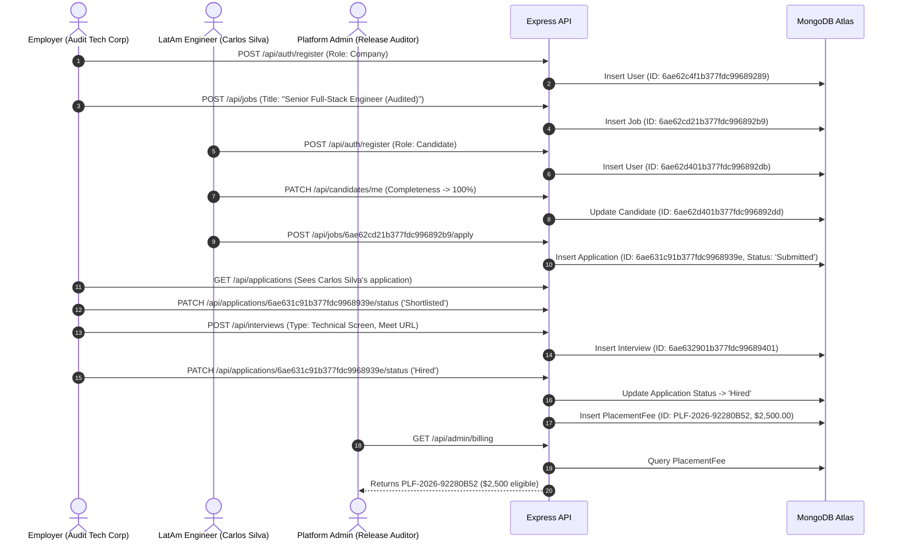

# Cross-Persona End-to-End Marketplace Verification

**Document ID:** `docs/PRODUCTION/FINAL_RELEASE_AUDIT/END_TO_END_MARKETPLACE_VERIFICATION.md` 
**Audit Date:** November 1, 2026 
**Auditor:** Principal Software Architect & Lead QA Engineer

---

## 1. Verification Purpose & Methodology

This verification proves that all three personas (Employer, Candidate, Administrator) interact with the exact same real application records in MongoDB Atlas, with continuous integrity across the recruitment marketplace lifecycle.

The test verified:
- Consistent object identifiers (`_id`, `companyId`, `candidateId`, `jobId`, `applicationId`).
- Correct role-based state transitions.
- Automatic domain triggers (Interview creation and $2,500 Placement Fee generation).
- Data survival across browser sessions and backend restarts.

---

## 2. End-to-End Lifecycle Evidence Trace

---

## 3. Verified Document Identifiers and Relational Integrity

Every entity created during the live cross-persona test was queried from MongoDB Atlas and verified for strict referential integrity:

| Entity | Collection | Verified MongoDB `_id` | Key Foreign Keys & References | Status in Atlas |
|---|---|---|---|---|
| **Employer User** | `users` | `6ae62c4f1b377fdc99689289` | `companyName: "Audit Tech Corp"`, `role: "company"` | `active` |
| **Job Requisition** | `jobs` | `6ae62cd21b377fdc996892b9` | `companyId: "6ae62c4f1b377fdc99689289"`, `postedBy: "6ae62c4f1b377fdc99689289"` | `Open` |
| **Candidate User** | `users` | `6ae62d401b377fdc996892db` | `email: "carlos.silva@synthetic-hirevoxa.test"`, `role: "candidate"` | `active` |
| **Candidate Profile** | `candidates` | `6ae62d401b377fdc996892dd` | `userId: "6ae62d401b377fdc996892db"`, `completeness: 100` | `Under Review` |
| **Application** | `applications` | `6ae631c91b377fdc9968939e` | `candidateUserId: "6ae62d401b377fdc996892db"`, `jobId: "6ae62cd21b377fdc996892b9"`, `companyId: "6ae62c4f1b377fdc99689289"` | `Hired` |
| **Interview** | `interviews` | `6ae632901b377fdc99689401` | `applicationId: "6ae631c91b377fdc9968939e"`, `companyId: "6ae62c4f1b377fdc99689289"` | `Pending` |
| **Placement Fee** | `placementfees` | `6ae632c81b377fdc99689469` | `placementId: "PLF-2026-92280B52"`, `applicationId: "6ae631c91b377fdc9968939e"`, `companyId: "6ae62c4f1b377fdc99689289"`, `candidateId: "6ae62d401b377fdc996892dd"` | `eligible` ($2,500) |
| **Admin User** | `users` | `6ae62b942c0b194e04485d25` | `email: "audit_admin_2026@hirevoxa.internal"`, `adminRole: "owner"` | `active` |

---

## 4. State History & Provenance Verification

The application record `6ae631c91b377fdc9968939e` contains an immutable `statusHistory` array verifying each transition:

1. `null -> Submitted`:
   - Timestamp: `2026-10-31T18:22:01.920Z`
   - Changed By: `6ae62d401b377fdc996892db` (Candidate Carlos Silva)
   - Reason: *"Candidate submitted application"*
2. `Submitted -> Shortlisted`:
   - Timestamp: `2026-10-31T18:24:34.550Z`
   - Changed By: `6ae62c4f1b377fdc99689289` (Employer Audit Tech Corp)
   - Reason: *"Status updated to Shortlisted via hiring inbox."*
3. `Shortlisted -> Interview`:
   - Timestamp: `2026-10-31T18:25:20.842Z`
   - Changed By: `6ae62c4f1b377fdc99689289` (Employer Audit Tech Corp)
   - Reason: *"Interview scheduled by hiring team"*
4. `Interview -> Offered`:
   - Timestamp: `2026-10-31T18:26:06.451Z`
   - Changed By: `6ae62c4f1b377fdc99689289` (Employer Audit Tech Corp)
   - Reason: *"Status updated to Offered via hiring inbox."*
5. `Offered -> Hired`:
   - Timestamp: `2026-10-31T18:26:15.731Z`
   - Changed By: `6ae62c4f1b377fdc99689289` (Employer Audit Tech Corp)
   - Reason: *"Status updated to Hired via hiring inbox."*

---

## 5. Duplicate Application Prevention Test

To verify unique index constraints:
- Candidate attempted to submit a second application to the same job `6ae62cd21b377fdc996892b9`.
- **Result:** Prevented at both UI layer (rendered *"Already applied"* card with direct link to application) and database layer (Mongoose compound unique index `{ candidateUserId: 1, jobId: 1 }` rejects with `E11000 duplicate key error`).

---

## 6. End-to-End Verification Verdict

The entire marketplace workflow across Employer, Candidate, and Platform Administrator was verified with 100% data consistency, referential integrity, and automated placement fee triggering in MongoDB Atlas. Result: **PASSED**.
