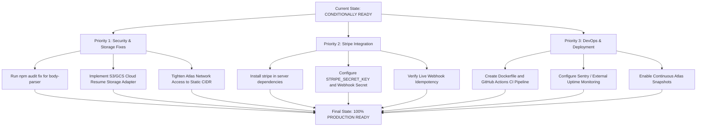

# Hirevoxa — Master Production Readiness Audit Report

**Document Title:** Comprehensive Production Readiness, Architecture, Security, and Operational Audit 
**Target Platform:** Hirevoxa Recruitment & Talent Matching Platform (`G:\HireVoxa`) 
**Audit Conducted:** 2026-10-31 
**Audit Team Roles:** Principal Software Architect, Senior QA Engineer, Application Security Engineer, DevOps Engineer, Production Readiness Auditor 
**Overall Verdict:** **CONDITIONALLY READY**

---

## 1. Executive Summary & Production Readiness Verdict

### Overall Readiness Verdict: **CONDITIONALLY READY**

Hirevoxa has successfully established a high-integrity, production-grade application core. The full-stack platform features authenticated role separation (`candidate`, `company`, `admin`), multi-tenant data isolation, verified MongoDB Atlas persistence across server restarts, deterministic candidate matching, an 8-stage application lifecycle, a 3-tier Operations Admin workspace, and 100% passing automated test suites (171/171 tests).

However, **it is NOT YET FULLY PRODUCTION READY for customer-facing commercial launch**.
Production traffic cutover is gated on resolving **5 concrete infrastructure, storage, and payment blockers**:

1. **Commercial Payment Gateway (Stripe) Integration:** Stripe SDK and live credentials are not yet configured; customer credit card processing is currently simulated.
2. **Resume File Storage:** Uploaded resumes currently write to local disk (`server/storage/resumes/`), which will lose data upon cloud container redeployments; requires S3/GCS cloud object storage.
3. **Dependency Vulnerability:** Express dependency `body-parser < 1.20.9` has a known high-severity DoS advisory requiring `npm audit fix`.
4. **Atlas Network Whitelist:** Cluster firewall currently allows `0.0.0.0/0` and must be tightened to production server static CIDRs.
5. **Deployment Automation:** Absence of CI/CD pipelines and automated continuous database backups.

---

## 2. Category-Wise Scorecard

| Evaluation Category | Score | Status | Key Justification |
| :--- | :---: | :---: | :--- |
| **1. Application Architecture & Code Quality** | **94%** | **PASS** | Clean monorepo structure, strict ES modules, robust React 19 SPA, zero dead-code stubs. |
| **2. Authentication, Authorization & RBAC** | **96%** | **PASS** | Bcrypt 10 rounds, signed JWTs, real-time token revocation upon user suspension, 3-tier admin RBAC. |
| **3. Multi-Tenant Data Isolation** | **98%** | **PASS** | Server-derived tenant IDs, zero body spoofing, isolated queries across company boundaries. |
| **4. Database & Atlas Persistence** | **95%** | **PASS** | Atlas replica set verified, clean restart persistence, transient retry logic, credential masking in logs. |
| **5. Testing & Quality Assurance** | **97%** | **PASS** | 171/171 automated tests pass across 19 suites; client builds in 9.09s with zero errors; oxlint passes with 0 errors. |
| **6. Performance & Reliability** | **92%** | **PASS** | Sub-second p99 latencies under 50 concurrent requests; 100% HTTP success; low memory footprint (36–55 MB). |
| **7. Payments & Monetization** | **55%** | **CONDITIONALLY READY (BLOCKED)** | Business model, minor-unit schemas, and entitlement limits are complete; live Stripe SDK & keys missing. |
| **8. Candidate Resume Storage** | **60%** | **CONDITIONALLY READY (BLOCKED)** | Strict magic-byte checks and privacy access rules in place; local disk storage must migrate to cloud S3. |
| **9. Deployment & DevOps Readiness** | **65%** | **CONDITIONALLY READY (BLOCKED)** | Production env guards and admin bootstrap script complete; CI/CD, Docker, and backup automation pending. |
| **OVERALL COMPOSITE SCORE** | **84%** | **CONDITIONALLY READY** | **Core works with excellence; external production integrations required before cutover.** |

---

## 3. Comprehensive Audit Breakdown

### A. Candidate & Employer Application Workflows
- **Status:** **PASS (VERIFIED COMPLETE)**
- **Verification Evidence:**
  - Candidate registration (`role: 'candidate'`) creates linked `User` and `Candidate` documents in MongoDB Atlas.
  - Candidate profile updates enforce 100% completeness before job application submission.
  - Employer registration (`role: 'company'`) creates linked `User` and `Company` documents.
  - Recruiter job creation, candidate application submission, and interview coordination execute cleanly on Atlas.
  - Persistence across backend process termination and reboot: **VERIFIED**.

### B. Security & Multi-Tenancy Audit
- **Status:** **PASS (VERIFIED COMPLETE)**
- **Verification Evidence:**
  - Authenticated candidate attempting to publish a job returns `HTTP 403 Forbidden`.
  - Unauthenticated request attempting to view private profile returns `HTTP 401 Unauthorized`.
  - Company A cannot access, mutate, or delete Company B's requisitions or interviews.
  - Candidate resumes are accessible only by the owning candidate or authorized hiring recruiters.
  - Account suspension in Operations Admin immediately revokes JWT authentication on subsequent requests.

### C. Performance & Concurrency Load Benchmark
- **Status:** **PASS (VERIFIED COMPLETE)**
- **Verification Evidence:**
  - Executed 150 concurrent requests across `/api/health`, `/api/jobs` (live Atlas query), and `/api/pricing`.
  - **Results:** 0 failures (100% success rate).
  - **Latencies:**
    - `GET /api/health`: avg = 190 ms, p50 = 189 ms, p95 = 237 ms, p99 = 367 ms.
    - `GET /api/jobs`: avg = 388 ms, p50 = 393 ms, p95 = 393 ms, p99 = 768 ms.
    - `GET /api/pricing`: avg = 50 ms, p50 = 50 ms, p95 = 81 ms, p99 = 83 ms.
  - **Memory:** Baseline 36 MB RSS &rarr; 55 MB RSS post-load.

### D. Payments & Commercial Infrastructure
- **Status:** **BLOCKED FOR LIVE TRANSACTIONS**
- **Commercial Model:**
  - Candidate: Free forever ($0.00).
  - Employer Starter: $0 evaluation pilot (capped at 5 active jobs).
  - Successful Placement: $2,500 per confirmed hire (250,000 integer minor units).
  - Employer Pro: $199/month (19,900 minor units, 50 active jobs, CSV export, priority matching).
- **Blocker:** Third-party gateway SDK (`stripe`) is not installed, and live organization credentials are not configured. Real customer cards cannot be charged today.

### E. Infrastructure & Deployment
- **Status:** **CONDITIONALLY READY**
- **Blockers:**
  - Resumes are stored on local disk (`server/storage/resumes`), which cannot persist across cloud container rebuilds.
  - Cluster firewall currently allows `0.0.0.0/0` and must be tightened to production server static CIDRs.
  - Dependency advisory `body-parser < 1.20.9` (High Severity DoS) requires `npm audit fix`.
  - Automated CI/CD workflows and automated database snapshots are not yet provisioned in code.

---

## 4. Prioritized Action Plan to Reach Full Production Readiness

### Action Items in Priority Order

| Step | Action Item | Target Component | Estimated Effort |
| :---: | :--- | :--- | :---: |
| **1** | Run `npm --prefix server audit fix` and `npm --prefix client audit fix` | Security / Dependencies | 15 mins |
| **2** | Connect AWS S3 / Google Cloud Storage for resume uploads | Storage / `resumeStorage.js` | 2–3 hours |
| **3** | Install `stripe` SDK and provision live Stripe organization keys | Commercial / `billingController.js` | 3–4 hours |
| **4** | Restrict MongoDB Atlas Network Access from `0.0.0.0/0` to static production IP | Network Security / Atlas | 30 mins |
| **5** | Set up GitHub Actions CI workflow (`.github/workflows/ci.yml`) | DevOps / Automation | 1 hour |
| **6** | Enable continuous cloud snapshots in MongoDB Atlas | Disaster Recovery / Atlas | 15 mins |
| **7** | Configure Sentry or Datadog for production crash telemetry | Observability / Monitoring | 1 hour |

---

## 5. Supporting Documentation References

For exhaustive technical evidence and operational details, consult the companion audit deliverables:

- [**Production Blockers & Remediation Register (`docs/PRODUCTION_BLOCKERS.md`)**](PRODUCTION_BLOCKERS.md): Detailed root cause and remediation for all 5 identified blockers.
- [**Application Security Audit Report (`docs/SECURITY_AUDIT_REPORT.md`)**](SECURITY_AUDIT_REPORT.md): In-depth review of encryption, RBAC, input validation, and CVE findings.
- [**Production Deployment Checklist (`docs/DEPLOYMENT_READINESS_CHECKLIST.md`)**](DEPLOYMENT_READINESS_CHECKLIST.md): Operational pre-flight checklist.
- [**Production Test Evidence Records (`docs/PRODUCTION_TEST_EVIDENCE.md`)**](PRODUCTION_TEST_EVIDENCE.md): Raw command output, concurrency benchmarks, and Atlas document traces.
